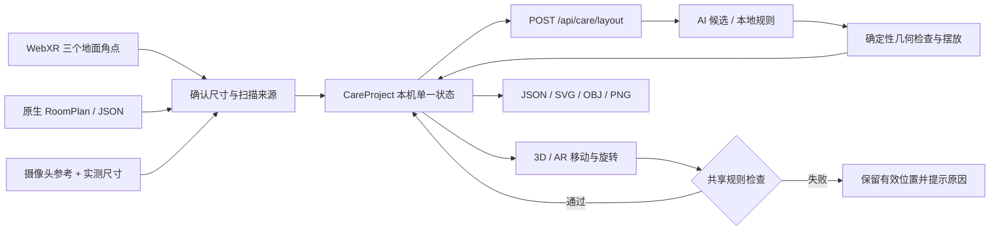

# Domira Care MVP：模块、数据流与验收

版本：2026-11-04。生产分支 `v2.0`。本目录与原 Domira Studio 共用现有 Node / Cloudflare 项目。

## 入口与已实现流程

| 路径 | 职责 |
| --- | --- |
| `/` | 新介绍网站：大幅 3D 空间、介绍、订制入口、两个产品入口、联络表单。采用 Tesla 式简洁介绍与配置节奏，未使用 Tesla 商标或素材。 |
| `/studio.html` | 原 Domira Studio，保留原来的平面图、全屋、渲染、报价等工作流。 |
| `/care.html` | 独立的适老设计工作台：扫描、需要配置、3D / AR 编辑、规则检查、自主导出、完整 Excel 资料库。 |
| `/login.html` | 注册、登录、账户状态、退出与访客入口。账户服务与设计流程解耦；登录不代表专案已上传云端。 |

用户从介绍页进入三步需要问卷：先选择活动方式、用途、风格与偏好，再挑选16类辅助器具和6类家具，最后确认房间尺寸并自动规划。可先用明确标记的示范尺寸，或先扫描房间；扫描后沿用同一份选择自动规划。后端根据用途、风格和活动方式获取 AI 位置候选，严格锁定客户选择的产品、数量和尺寸，按确定性几何规则检查或重新摆放；AI 不可用时明确标示本地规则模式。家具可在 3D 或兼容设备的 AR 中移动、旋转。无效操作保留上一次有效位置。用户可导出 JSON、SVG、OBJ、PNG。

本 MVP 没有付款、交易订单或电商结账；“订制”入口进入设计配置。未实现跨设备专案同步。

## 模块边界

| 模块 | 文件 | 输入 / 输出与职责 |
| --- | --- | --- |
| 介绍、联络 | `public/index.html`, `landing.*` | 原创 3D 介绍画面及网站导航；POST 联系接口，不接触扫描权限。 |
| 账户 UI | `public/login.html`, `auth-client.js` | 只提交 Email / 密码，保存短期会话令牌；不在浏览器持久化密码。 |
| 账户 API | `worker/auth.js` | 使用现有 `RENDER_DB` D1 绑定，新增独立 `care_users` / `care_sessions` 表；PBKDF2-SHA256、100000 次迭代、独立随机 salt；只存令牌 SHA256；会话最长 12 小时。 |
| 扫描适配 | `scan-studio.js`, `xr-scan.js`, `scan-domain.js`, `xr-support.js` | 能力检测、权限、相机资源释放、WebXR 三点测量、RoomPlan 桥接或 JSON 校验，输出经确认的 `room`。原始照片不进入专案或 AI 请求。 |
| 编辑控制 | `public/care-app.js` | 单一专案状态、撤销、有效变换、保存、导入导出、资料库交互；异步生成失效处理，避免覆盖后续编辑。 |
| 适老规则 | `public/care-domain.js` | 浏览器与 Worker 共用校验器；严格旋转矩形碰撞、边界、层高、入口、中央通道和迴转区；输出 failures / pending，不签发合规证书。 |
| AI 编排 | `worker/care.js` | 复用已配置 DeepSeek / 上游布局服务；只允许合法候选进入规则层。候选放不下便跳过，家具不会为了满足规则而自动缩小。 |
| 3D / AR | `scene.js`, `furniture.js`, `care-furniture.js` | 尺度一致的显示；真实 WebXR hit-test 放置；触点 / 控制器射线与地面相交实现拖动，保留抓取偏移；15°旋转。器具外观是类别示意，外形包络按输入尺寸。 |
| 设计前问卷 | `care-onboarding.js`, `care-brief.js`, `care-catalog.js` | 三步选择、数量与尺寸、偏好、空间确认；共享验证及严格产品展开。 |
| 产品展示 | `care-model-preview.js` | 共享渲染器生成22种模型缩略图，单独旋转查看；释放预览渲染资源。 |
| 资料库 | `care-data.js`, `scripts/import-care-workbook.py` | 只读导入全部原始字段、行号和来源哈希。供浏览 / 搜寻 / 现场核对；并非将原表所有文字自动视为现行法例。 |
| 部署 | `scripts/build*.mjs`, `.github/workflows/cloudflare-sync.yml` | 两个 Worker 从同一提交生成；部署后核对版本、资产清单和每个文件的 SHA256。 |

## 扫描 → 规划 → 编辑 → 导出



数据约定：`format = domira.care.v1`，所有尺寸及坐标单位为 m；右手坐标，Y 向上，房间地板中心为原点，家具落地；`x/z` 是家具中心位置。`rotation` 为角度，零度朝 +Z，90° 朝 −X，与 3D、SVG 和 AR 保持一致。入口当前固定为平面图下方中央，必须实地确认。

核心专案结构示例：

```json
{
  "format": "domira.care.v1",
  "id": "uuid",
  "name": "我的乐龄空间",
  "room": {"width": 6, "depth": 4.5, "height": 2.7, "source": "manual-guided"},
  "profile": "wheelchair",
  "purpose": "living",
  "style": "warm",
  "doorWidth": 0.9,
  "doorConfirmed": false,
  "items": [{"id":"item-uuid","type":"chair","careKind":"wheelchair","name":"手动轮椅","w":0.68,"d":1.1,"h":0.94,"x":2,"z":0,"rotation":90,"color":"#a7b6a2","sourceRecordId":"AID-006","dimensionSource":"user-confirmed"}],
  "fieldChecks": {},
  "updatedAt": "ISO-8601"
}
```

示例尺寸只说明数据格式，不是具体商品规格或采购建议。RoomPlan / WebXR 原始测量及归一化信息保存在 `room.measurement`；导入时会重新校验，不盲信声称的房间尺寸。用户人工修正后保留原始测量，明确标记 `measured-adjusted`。编辑后直接更新同一份家具数组；AR 只变换显示容器，不把世界定位混入持久化房间坐标。JSON 导出可再次导入；重新导入会清除现场核对勾选，要求再次确认。

生成请求仅发送房间参数 / 测量结构、现有家具状态和设计选项，模型提示由服务端构建，不发送相机参考照片。专案默认存于当前浏览器 `localStorage`，扫描照片仅存在本次弹窗内存，关闭后清除。登录令牌位于当前分页面的 `sessionStorage`。

## 资料与适老标准

三步问卷数据以`project.brief`保存，格式`domira.care.brief.v1`，包含`selections: [{productId,quantity,w,d,h,dimensionSource}]`、六种可选偏好和最多500字补充说明。问卷确认前不自动请求布局；确认后只生成所选产品。修改及取消问卷不会暗中覆盖现有设计。原始选择与尺寸来源随JSON导出。

完整导入用户提供的《樂齡科技適老化資料庫 副本 副本.xlsx》：

| 原表 | 记录 | 网站用途 |
| --- | ---: | --- |
| ①无障碍规范与动线 | 16 | 原文浏览、搜寻、逐项现场核对 |
| ②辅助装置产品库 | 16 | 全部类别有独立模型，可先选概念尺寸，或核对实物整体宽深高 |
| ③分区改造方案 | 25 | 全部浴室、厨房、卧室、走廊、客厅、认知友好设计参考 |
| ④采购渠道与资助 | 16 | 全部渠道及原表网址，网址可点击 |
| 总计 | **73** | 保留每个字段、原表名称、原行号、原文件 SHA256 |

原表没有任何完整型号的整体 W / D / H；不可用座宽、座高或参考区间代替外形尺寸。所有16类器具有独立参数化造型与明确标记的概念包络尺寸；用户可在问卷修改整体宽深高并勾选实物核对。从 AI 产生的通用家具始终标为概念尺寸，现场复核状态保持待确认。16类均有独立类别外观，手动/电动轮椅、防滑垫/地砖等亦区分；另有6类通用家具。可单独旋转查看模型，或从产品模型库加入设计，再自由移动和旋转。放不下的选定产品保存在unplaced清单，不自动缩小或替换。防滑薄层例外只允许 AID-016 / AID-017、厚度不超过 30mm；其防滑及边缘平整仍须现场检查。

目前强制的项目设计目标为：

| 活动方式 | 中央连续通道净宽 | 已声明入口净宽 | 中央迴转直径 |
| --- | ---: | ---: | ---: |
| 步行 / 助行器 | 0.90m | ≥0.80m | 1.50m |
| 轮椅 / 照顾协助 | 1.20m | ≥0.85m | 1.50m |

以上为这个 MVP 的保守几何预留策略，不等于所有住宅都适用的法定下限。检查范围为矩形包络、连续中央通道、中央圆形净空、家具占地碰撞、边界、层高及声明门宽。几何失败不可导出；现场项目未完成可以导出明确标为草案的结果。21 项核对记录包括原表 16 项及地面 / 照明 / 实物适配 / 门槛救援 / 安装评估。检查结果永远包含 `certified: false`。

25 项分区设计均已展示，但目前并未自动检验其所有安装、温度、照度、使用者转移净空、厨房及卫浴细节，也未做全屋跨房间路径证明。家具当前统一落地，未实现扶手墙上安装高度或桌面药盒的依附关系。矩形包络不能证明不规则房间内部全部可用；原始墙面与矩形碰撞模型需另行核对。工程实施前应由适当专业人员结合使用者、实物、建筑条件和适用规定审核。网站不会把这些未完成项目显示为“全屋适老合规”。

原表含混合的旧规范、推荐值和业界惯例。现行官方参考应结合屋宇署 [APP-175（2026年8月）](https://www.bd.gov.hk/doc/en/resources/codes-and-references/practice-notes-and-circular-letters/pnap/APP/APP175.pdf)、[APP-176（2026年9月）](https://www.bd.gov.hk/doc/en/resources/codes-and-references/practice-notes-and-circular-letters/pnap/APP/APP176.pdf) 及 [Universal Accessibility 2026](https://www.bd.gov.hk/doc/en/resources/codes-and-references/code-and-design-manuals/DMUA2026e.pdf) 的适用条件与过渡安排逐项判断。原表价格、资助资格及其余文字只标作用户提供的参考，并未声称每项已重新市场核验。

## 扫描与 AR 的实际能力

| 设备 / 方式 | 已实现 | 必须说明的界限 |
| --- | --- | --- |
| 支持 immersive-ar + hit-test 的 WebXR 浏览器 | 三个相邻地面角点测量 → 公尺长宽 → 矩形参数房间；真实尺度放置、选取、拖动、旋转 | 需 HTTPS、用户授权、稳定地面定位；层高仍需实测。不是自动全屋网格重建。 |
| LiDAR + 原生 Apple RoomPlan | 已有原生桥接协议及测量 JSON 导入，校验原始墙面及归一化后重建显示 | 网页不能执行原生采集；仓库已有原生参考工程，本次未编译、签名或真机验证。Safari 无法直接调用 RoomPlan。 |
| 普通相机 / Safari | getUserMedia 相机参考、手动实测参数房间、可手动对齐的相机叠加 | 相机照片没有被包装成准确深度重建；叠加预览没有空间追踪。 |

参考：[Apple RoomPlan](https://developer.apple.com/augmented-reality/roomplan/)、[WebXR hit-test](https://www.w3.org/TR/webxr-hit-test-1/)。既有原生工程、桥接协议及硬件验收见 `native/DomiraRoomPlan/README.md`。宿主打开介绍站后，从 Care 入口进入扫描。

## 后端契约与运行

| API | 请求 | 主要返回 |
| --- | --- | --- |
| POST `/api/care/layout` | `{project, purpose, style}` | `{items, skipped, engine, notice, review}`；错误项目 400；上游失败切本地并说明。 |
| POST `/api/care/validate` | `{project}` | `{ok, failures, pending, status, certified:false, rulesVersion}`。 |
| POST `/api/auth/register` | `{email,password}` | 201，`{user,token,expiresAt,emailVerified:false}`；数据库未连接 503。 |
| POST `/api/auth/login` | `{email,password}` | 200，相同短期会话格式；错误凭证 401。 |
| GET `/api/auth/me` | `Authorization: Bearer <token>` | 账户信息；过期 / 无令牌 401。 |
| POST `/api/auth/logout` | 同上 | 删除会话并返回 `{ok:true}`。 |
| POST `/api/contact` | `{name,email,message,website:"",projectId?}` | 已配置 webhook 才转交给固定收件人 `info@duomo.ltd`；未配置时 503 + mailto，不假称发送成功。 |

账户使用至少12、至多128字元密码。IP限制为每个 Worker isolate 每分钟8次登录/注册尝试，不能替代生产级共享速率限制。当前未实现 Email 验证、密码重设、OAuth 或云端专案授权；正式大规模开放账户前需补齐这些能力。既有 D1 和渲染数据表保持不变，新表通过幂等 DDL 添加。

```text
public/
  index.html  landing.css  landing.js       # 介绍网站
  studio.html app.js                       # 原工作室
  login.html auth-client.js                # 登录
  care.html care.css care-app.js           # 独立适老工作台
  care-domain.js care-data.js              # 规则及完整原表
  care-brief.js care-catalog.js             # 选择契约与22类模型目录
  care-onboarding.js care-model-preview.js  # 需求问卷与产品展示
  media/                                   # 三组AI场景素材
  care-furniture.js scene.js furniture.js  # 3D / AR
  scan-studio.js scan-domain.js xr-scan.js  # 采集
worker/
  index.js auth.js care.js layout.js       # Worker API
scripts/
  dev.mjs build.mjs build-cloudflare.mjs verify-cloudflare.mjs
  import-care-workbook.py                  # 可重复导入（openpyxl，只读）
tests/care.test.mjs                        # 新模块回归测试
cloudflare/                               # 两个现有 Worker 配置
```

Node 24：

```sh
npm ci
npm run dev
# 浏览器打开 http://localhost:3000
npm test
npm run build
npm run validate
npm run build:cloudflare
node scripts/check-v2-bundles.mjs
```

本地开发没有 D1 时账户 API 明确返回 503，可用访客体验；生产复用 API Worker 已存在的 `RENDER_DB`。AI 可使用 `DEEPSEEK_API_KEY`、现有 `RENDER_PROXY_ORIGIN`，或 `LAYOUT_ENDPOINT` / `LAYOUT_API_KEY`。`CONTACT_WEBHOOK_URL` / `CONTACT_WEBHOOK_TOKEN` 预留给实际邮件服务；网站同时提供 mailto。密钥只放 Worker Secrets，不提交到仓库。

## 验收标准

| 项目 | 通过条件 / 验证方式 |
| --- | --- |
| 设计前需要 | 未确认前无布局请求；选择后自动规划；生成产品及数量只来自已确认选择；扫描后仍保留选择；超大产品保留未放入清单。 |
| 首页动画 | 客厅/浴室/睡房AI场景素材搭配镜头推进、光影、动线及交叉淡入；可切换/暂停，尊重减少动态效果偏好。素材及提示词见`docs/ai-scenes.md`；不是生成式视频或真实工程案例。 |
| 双入口 | 首页能分别打开原 Studio、Care 与登录；原工作室继续正常载入。 |
| 资料完整 | 4 张表记录数为 16 / 16 / 25 / 16；逐字段与原 Excel 一致；可分类搜寻，全部16器具可填写实际尺寸加入。 |
| 摄像头引导闭环 | 允许相机 → 参考拍摄 → 填入实测长宽高 → 确认 → 3D 房间 → 生成；拒绝权限仍能实测建模。关闭弹窗 / 离开页面关闭流。 |
| 参数和来源 | 房间与家具均保留单位、测量来源、实物 / 概念尺寸来源；改变尺寸后不复用旧现场核对。 |
| 几何检查 | 旋转家具、30mm细辅具重叠、毫米级穿透、边界、层高、门宽、通道与迴转区测试通过；伪造 surface / rug 不能绕过检查。 |
| 交互 | 拖动及15°旋转可生效；无效变换回退；撤销可恢复；新增器具不重排已有编辑；异步生成不会覆盖更新的设计。 |
| 自主导出 | JSON 可再次导入；SVG 保留位置、朝向与通道；OBJ 以公尺输出；PNG 不包含相机影像；几何失败不能导出。 |
| 登录 | SQL适配器验证注册哈希、正确 / 错误密码、me、退出、数据库不可用；UI支持注册 / 登录切换，不被隐藏确认框阻挡。 |
| 联系 | 参数无效400，未配置503，有配置才转交；不向用户显示虚假的送达。 |
| 桌面 / 手机 | 1440px 与390px宽度布局无水平溢出；重要按钮可见；无浏览器未捕获异常。 |
| WebXR 真机（待硬件验收） | 支持设备完成三点实测；在已知1m参照物旁确认1:1尺度；触点拖动保留偏移，旋转与检查一致；跟踪丢失、权限拒绝和退出后资源释放。 |
| RoomPlan 真机（待原生宿主验收） | LiDAR原生结果导入同一专案；原始墙面、尺寸、坐标归一化与编辑 / 导出一致。 |
| Cloudflare | CI全部检查通过；frontend `/deployment-info.json` 与API `/api/version` 等于已推送 Git SHA；全部资产 SHA256 检查通过。 |

软件自动化通过不代表以上真机或工程适配项目已完成；真机结果不得用桌面模拟替代。

需要选择作为设计的一部分保存；已摆放与待摆放始终从requestKey核算，模型、数量、尺寸及来源不一致的导入会被拒绝。扫描确认前保持原设计，取消不会清空配置；成功后保留已选需要、风格和入口净宽。
